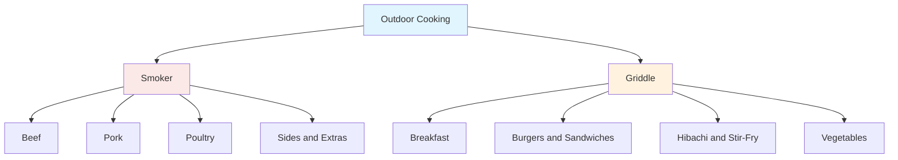

# Smoker and Griddle Recipes

This is my collection of recipes and notes for cooking outdoors on the smoker and the flat-top griddle. It covers the recipes I come back to, the temperatures and times that work on my equipment, and what I learned from each cook.

## Overview



## Smoker Recipes

Low and slow cooks where wood, smoke, and time do most of the work.

### 🥩 [Beef](smoker/beef.md)

**Coming Soon** - Planned recipes:

- Brisket (packer and flat)
- Beef ribs (plate and chuck)
- Tri-tip and reverse-seared steaks
- Smoked chuck roast

### 🐖 [Pork](smoker/pork.md)

- [Stuffed Pork Tenderloin](smoker/pork.md#stuffed-pork-tenderloin)

**Coming Soon** - Planned recipes:

- Pulled pork (pork butt)
- Spare ribs and baby back ribs
- Pork belly burnt ends
- Smoked sausage

### 🍗 [Poultry](smoker/poultry.md)

- [Smoked Whole Chicken](smoker/poultry.md#smoked-whole-chicken)
- [Smoked Chicken Wings and Thighs](smoker/poultry.md#smoked-chicken-wings-and-thighs)
- [Smoked Chicken Breast](smoker/poultry.md#smoked-chicken-breast)
- [Smoked Whole Turkey](smoker/poultry.md#smoked-whole-turkey)
- [Smoked Turkey Breast](smoker/poultry.md#smoked-turkey-breast)

### 🧀 [Sides and Extras](smoker/sides.md)

**Coming Soon** - Planned recipes:

- Smoked mac and cheese
- Baked beans
- Rubs, sauces, and brines

## Griddle Recipes

Hot and fast cooks on the flat-top.

### 🍳 [Breakfast](griddle/breakfast.md)

**Coming Soon** - Planned recipes:

- Pancakes and French toast
- Bacon, sausage, and eggs
- Hash browns and breakfast potatoes

### 🍔 [Burgers and Sandwiches](griddle/burgers-sandwiches.md)

**Coming Soon** - Planned recipes:

- Smash burgers
- Philly cheesesteaks
- Quesadillas

### 🥢 [Hibachi and Stir-Fry](griddle/hibachi-stir-fry.md)

**Coming Soon** - Planned recipes:

- Hibachi chicken, steak, and shrimp
- Fried rice
- Yakisoba and lo mein

### 🥦 [Vegetables](griddle/vegetables.md)

**Coming Soon** - Planned recipes:

- Griddled onions and peppers
- Zucchini and squash
- Corn and asparagus

## Quick Reference

### Safe Minimum Internal Temperatures

These are USDA minimums for food safety. Many smoker cooks, such as brisket and pulled pork, are taken well past these temperatures so that the connective tissue breaks down.

| Food | Minimum Internal Temp | Notes |
| --- | --- | --- |
| Poultry (whole, parts, ground) | 165°F (74°C) | |
| Ground beef and pork | 160°F (71°C) | |
| Beef, pork, lamb (steaks, roasts, chops) | 145°F (63°C) | Rest 3 minutes |
| Fish and shellfish | 145°F (63°C) | |

### Common Smoker Targets

| Cut | Smoker Temp | Typical Finish Temp |
| --- | --- | --- |
| Brisket | 225–275°F | 200–205°F, probe tender |
| Pork butt | 225–275°F | 195–205°F, probe tender |
| Pork ribs | 225–250°F | Bend test, ~195–203°F |
| Whole chicken | 275–325°F | 165°F in the breast |

### Wood Pairings

| Wood | Flavor | Pairs Well With |
| --- | --- | --- |
| Hickory | Strong, bacon-like | Pork, beef |
| Oak | Medium, balanced | Beef, brisket |
| Mesquite | Very strong, earthy | Beef (use sparingly) |
| Apple | Mild, sweet | Pork, poultry |
| Cherry | Mild, fruity, adds color | Pork, poultry, ribs |
| Pecan | Medium, nutty | Pork, poultry |

### Griddle Heat Zones

| Zone | Approx. Surface Temp | Use For |
| --- | --- | --- |
| High | 400–450°F+ | Smash burgers, searing, fried rice |
| Medium | 350–375°F | Bacon, cheesesteaks, vegetables |
| Low | 300–325°F | Pancakes, eggs, French toast |
| Warming | Burner off or lowest | Holding finished food, toasting buns |

## Recipe Template

New recipes in this section follow this layout:

```markdown
# Recipe Name

| | |
| --- | --- |
| **Cooker** | Smoker or Griddle |
| **Prep time** | |
| **Cook time** | |
| **Servings** | |
| **Cook temp** | |
| **Target internal temp** | |
| **Wood** | (smoker only) |

## Ingredients

## Instructions

## Notes
```

The Notes section is for what changed from the last cook: weather, timing, what worked, and what to try next time.
